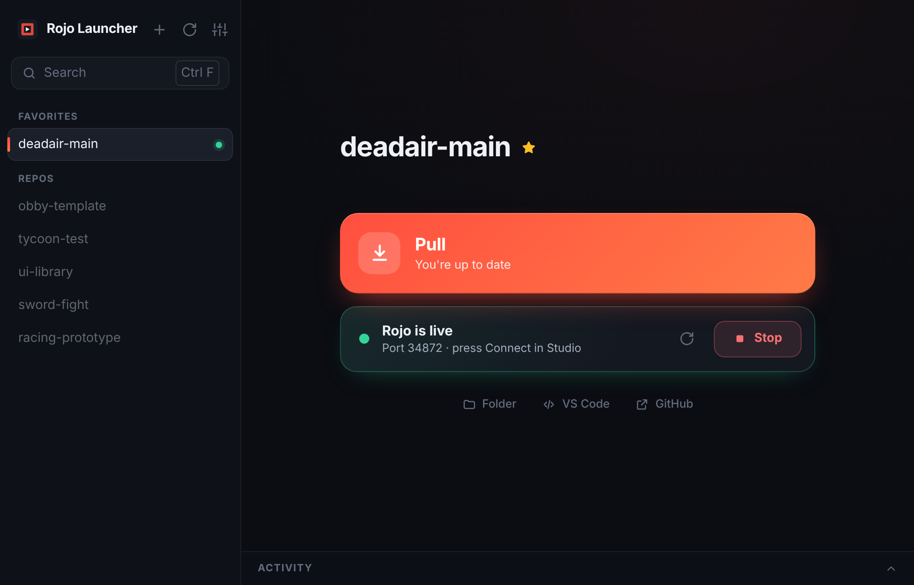

# Rojo Launcher

Pick a repo, press **Pull** to get the latest from GitHub, then press **Start** to run `rojo serve`. In Studio, press **Connect** in the Rojo plugin.

## How it works

- **Pull** (the big button) gets the latest from GitHub. The first time, it downloads the repo instead. It shows how many new changes are waiting before you press it.
- **Start / Stop** runs `rojo serve` for that repo. If you press Start while a pull is running, Rojo starts as soon as the pull finishes. Switching to another repo stops the old server first, so the port is never left busy.
- Your unsaved changes are never overwritten. If a pull can't go ahead, the app tells you and leaves your files alone.
- **Favorites:** press the ★ next to a repo's name to keep it at the top.
- **Add any repo** with the **+** button: type `owner/repo` or paste the GitHub link. It can be anyone's repo, and it goes into your Favorites. Repos you added have a **Remove** link (this only takes them off the list; the folder on your computer stays).
- **Updates:** the app checks for a new version when it opens and every few hours. When there is one, an **Update** button appears at the bottom left. Press it and the app updates itself and reopens, and Rojo keeps running for the repo you had open. You can also check by hand in Settings.
- Keys: Enter = Pull, Ctrl+Enter = Start/Stop, ↑/↓ = switch repo, Ctrl+F = search, Ctrl+N = add a repo, F5 = refresh (⌘ instead of Ctrl on a Mac).
- Closing the window stops Rojo.

## Install

### Mac

1. Download `RojoLauncher-Mac.dmg` and open it.
2. Drag **Rojo Launcher** onto the **Applications** folder next to it.
3. Open Rojo Launcher from Launchpad, Spotlight or the Applications folder. Right-click its Dock icon and choose **Options → Keep in Dock** if you want it there.

The first time only, the Mac says it can't check the app (it isn't from the App Store or a paid Apple developer account). Click **Done**, then open **System Settings → Privacy & Security**, scroll down and click **Open Anyway** next to Rojo Launcher. Or run this once in Terminal instead:
`xattr -cr "/Applications/Rojo Launcher.app"`

It runs on Apple Silicon and Intel Macs (macOS 11 or newer) and needs no Python. If you open it straight from the download, it offers to **Move to Applications** itself. It also removes the old "Rojo Launcher" shortcut the Python version made. Updates install in place: press **Update** and it reopens on the new version.

### Windows

Download `RojoLauncher-Windows.zip`, unzip, and open **Rojo Launcher**. No Python needed. Windows may say "Windows protected your PC" because the app isn't signed. Click **More info → Run anyway**.

### From the Python file

Install [Python 3](https://www.python.org/downloads/) (on Windows tick "Add Python to PATH"), double-click `rojo_launcher.py`, then press **Add to Desktop** in the app. On a Mac, use the app above instead.

You also need:
- **Git**: [git-scm.com](https://git-scm.com/downloads)
- **Rojo**: via Aftman/Rokit or the [Rojo releases](https://github.com/rojo-rbx/rojo/releases).

## Private repos

Open **Settings** and paste a token: [make one here](https://github.com/settings/tokens/new?scopes=repo&description=Rojo%20Launcher) (a classic token with "repo" ticked). If you use the GitHub CLI (`gh auth login`), or Git already has your GitHub login saved, it works without a token.

Settings are stored in `~/.rojo-launcher.json`.

## Publishing a new version (for whoever maintains this)

The app looks for updates in the `ChocoBasta/RojoLauncher` repo (`UPDATE_REPO` near the top of `rojo_launcher.py`).

1. Raise `APP_VERSION` in `rojo_launcher.py` and push it to `main`. Copies running from the Python file update from that file.
2. Push a tag with the same number, such as `v3.2`. The GitHub Action in `.github/workflows/build.yml` builds the Windows .exe and the Mac app with PyInstaller and attaches them to a Release (`RojoLauncher-Windows.zip`, `RojoLauncher-Mac.dmg`, and `RojoLauncher-Mac.zip`, which the Mac app updates from). The .exe and the Mac app update from the latest Release.

The Mac build runs on GitHub's Mac machines: a universal app (Apple Silicon + Intel) from python.org's Python, signed ad hoc (free, no Apple account), with the icon from `mac/icon.png` (drawn by `mac/make_icon.py` on Apple's icon grid). Before it packs the `.dmg`, it opens the app for real and checks it starts on both chip types, finds `rojo` through your shell's PATH, opens its window, moves itself to Applications and updates itself in place (`mac/check.py`).
